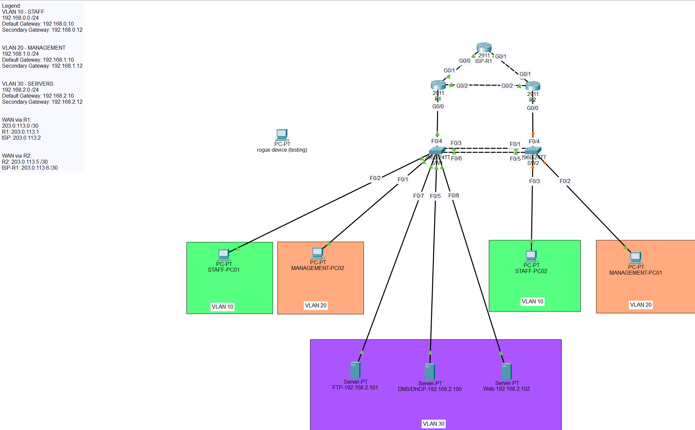

# Enterprise Network Lab

A hands-on Cisco Packet Tracer project: a small enterprise network that I designed, configured, secured, broke on purpose and fixed. It's an ongoing project. Each milestone is saved as a separate `.pkt` file so the progression stays visible.

I'm a CCNA-certified IT support specialist moving into network engineering. This lab is where I practise the part certifications don't cover: understanding *why* a network behaves the way it does, and proving it with CLI evidence.

## The network (Frankfurt site)

| Area | What's built |
|---|---|
| Devices | 2 × Cisco 2911 routers (R1, R2), 2 × Cisco 2960 switches (SW1, SW2), 1 × 2911 as ISP |
| Segmentation | VLAN 10 STAFF, VLAN 20 MANAGEMENT (IT), VLAN 30 SERVERS; native VLAN 999 |
| Inter-VLAN routing | Router-on-a-stick on both routers |
| Gateway redundancy | HSRP on all three VLANs (R1 active, priority 110, preempt) |
| Switching | Rapid-PVST+ (SW1 root), LACP EtherChannel between the switches |
| Routing | OSPF area 0 between R1 and R2 (transit link, loopbacks, user VLANs as passive interfaces); static default routes to the ISP, advertised into OSPF as backup |
| Internet edge | PAT on both routers, dual WAN links |
| Services | Centralized DHCP (relayed by both routers), DNS, FTP, HTTP/HTTPS |
| Security | Extended ACL for STAFF, port security, DHCP snooping, Dynamic ARP Inspection, SSH-only management restricted to the MANAGEMENT VLAN, unused ports shut down |

## What I tested and what I found

The interesting part of this project isn't the configuration. It's what testing revealed. A few examples:

- **HSRP only watches the LAN.** When R1's WAN link failed, R1 stayed HSRP active and blackholed all Internet traffic. Fixed with `default-information originate`, so R1 learns a backup default route from R2 via OSPF.
- **The ISP's routes were hiding NAT failures.** The ISP had routes back to the private networks, so the "Internet" kept working even if NAT broke. I removed them and added a simulated Internet host.
- **A stateless ACL broke return traffic.** IT could send to STAFF PCs but never got a reply. Fixed with `established` and `echo-reply` entries, replaced on the live interface in one step with a rollback copy kept.
- **One output isn't the truth.** Packet Tracer showed a router as HSRP active with its interface down. I confirmed the real state through the peer, the logs and a traceroute.

Full write-ups: [docs/troubleshooting/findings.md](docs/troubleshooting/findings.md)

## Documentation

| Document | Content |
|---|---|
| [Design decisions](docs/architecture/design-decisions.md) | Why the network is built this way, alternatives considered, trade-offs |
| [Verification](docs/testing/verification.md) | Tests performed and their results (only tests that were actually run are marked as verified) |
| [Troubleshooting findings](docs/troubleshooting/findings.md) | Problems found through testing: symptom, root cause, fix, verification |
| [Milestones](topology/frankfurt/README.md) | The `.pkt` files and what each one added |

## Try it yourself

Download the latest `.pkt` from `topology/frankfurt/` and open it in Cisco Packet Tracer. `LabPasswords.txt` contains generated, lab-only credentials, published on purpose so you can access the device CLIs. They aren't used anywhere else.

Built something differently, or found a better approach? I'd like to hear about it.

LinkedIn: https://www.linkedin.com/in/alexei-kurakin/
